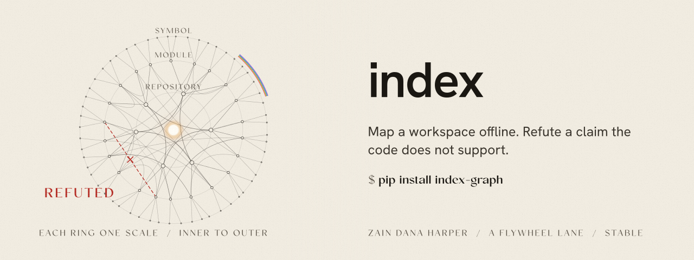

<picture>
  <source media="(prefers-color-scheme: dark)" srcset="docs/art/hero-dark.svg">
  
</picture>

# index

Index maps your code offline. It shows how your repositories depend on each other, what calls what inside one repo, and which docs describe which code. Each map is one HTML file you open in a browser.

[](https://pypi.org/project/index-graph/)
[](https://github.com/HarperZ9/index/actions/workflows/ci.yml)
[](LICENSE)


[Project Telos](https://harperz9.github.io) | [gather](https://github.com/HarperZ9/gather) | [crucible](https://github.com/HarperZ9/crucible) | [index](https://github.com/HarperZ9/index) | [forum](https://github.com/HarperZ9/forum) | [telos](https://github.com/HarperZ9/telos) | [learn](https://github.com/HarperZ9/learn) | [emet](https://github.com/HarperZ9/emet) | [buildlang](https://github.com/HarperZ9/buildlang)

Index reads manifests and imports in Python, JavaScript and TypeScript, Rust, Go, Java, C#, Ruby, PHP, and C and C++. Every dependency edge it draws carries the file and line it came from. It needs Python 3.11 or newer and nothing else: no runtime dependencies, no server, no account, no model, no network. The PyPI package is `index-graph` and the command is `index`.

Use it when you want to:

- read an unfamiliar repository through a generated wiki of its modules, functions and callers;
- see how a folder of many repositories fits together, with the docs placed next to the code they describe;
- fail a CI build when an import breaks the layering you declared;
- choose what code an AI agent sees, under a token budget, with a list of what was left out.

Coverage differs by level. Repository-level dependencies cover all nine ecosystems. Module-level maps inside one repository cover Python, JavaScript and TypeScript, Rust and Go. Function-level features (callers, callees, go-to-definition, the per-function wiki pages) cover Python only.

## Quickstart

```bash
pip install index-graph
```

Map one repository into a wiki, then check the wiki against the code later:

```bash
index wiki --root path/to/repo --out wiki.html
index wiki --verify wiki.html --root path/to/repo
# verdict=MATCH pages=51 edges=314        (exit 0; DRIFT=1, UNVERIFIABLE=2)
```

The wiki has an overview, one page per module with its imports and dependents, one page per Python function, class and method with its callers and callees, and an architecture diagram drawn from the import graph. Index writes no prose of its own. `--verify` returns DRIFT when an import or call the wiki shows has gone from the code, when a page in the file was edited, or when the repository moved to a new commit. It checks what the wiki states. Code you add without committing can still read MATCH.

Map a folder that holds several repositories, with every view on one page:

```bash
index workbench --root path/to/workspace --out workbench.html
# workbench -> workbench.html  (3 repos, 192 docs, ...)
```

Find who calls a Python function:

```bash
index symbols build_route --root path/to/repo --refs
# references (4 resolved, 0 unresolved):
#   src/index_graph/route::cmd_route  src/index_graph/route.py:179  [exact, high]
#   ...
```

Ask whether one repository depends on another:

```bash
index verify --root path/to/workspace --depends "telos -> proof-surface"
# verdict=REFUTED: no dependency telos -> proof-surface in the graph   (exit 1)
```

Find the code that answers a question in plain words. The default chooser is lexical and runs locally:

```bash
index navigate path/to/repo "wiki verify drift"
```

The outputs above come from `index-graph` 2.16.0, installed from PyPI into a fresh virtual environment, run on this repository and two neighbours. Rendered samples ship with the repo if you want to look first: [`examples/wiki-demo.html`](examples/wiki-demo.html) for the single-repo wiki and [`examples/atlas-demo.html`](examples/atlas-demo.html) for the workspace atlas. They regenerate with `python examples/wiki_demo.py` and `python examples/atlas_demo.py`. [`docs/INTRODUCTION.md`](docs/INTRODUCTION.md) is a ten-minute walkthrough.

## How it compares

- **Model-written wikis such as DeepWiki.** These explain a codebase in prose written by a language model. `index wiki` derives every page from the import and call graph, so it explains less, and you can re-run the check at any time.
- **Repository packers such as Repomix.** These put source into one file for a model to read. `index navigate` hands a model the few functions that match a question, and `index context-envelope` fills a token budget and lists each repository it dropped with a reason code such as `budget_exceeded`.
- **Dependency graphers such as pydeps, madge and dependency-cruiser.** Each covers one language ecosystem inside one repository and goes deeper there. Index draws one graph across many repositories and nine ecosystems, and joins markdown docs to it.
- **Layer checkers such as import-linter and ArchUnit.** `index check` enforces layers, forbidden imports and a cycle limit from `.index.toml`, between repositories in all nine ecosystems and between modules in the four above. import-linter (Python) and ArchUnit (Java) offer more contract types.
- **Code navigation such as Sourcegraph, ctags or an IDE language server.** These index many languages precisely. `index symbols` and `index lsp` cover Python only and work from a static graph with no service to run.

---

## See it work, step by step

The [animated explainer](https://harperz9.github.io/repo-explainers/index-graph.html)
walks through a three-module package: the module graph with a file and line on every edge, symbol references, the wiki, a back-import that creates a cycle, the architecture rule that fails on it, and the wiki check reading DRIFT, MATCH and UNVERIFIABLE. Every value on it is output from this repository. Its
source is [docs/explainer/index.html](docs/explainer/index.html).

## Watch

[](https://harperz9.github.io/explainers.html#rederive-h)

**[Re-derive it. Don't take it on trust.](https://harperz9.github.io/explainers.html#rederive-h)** (2 min 5 s, narrated, captioned). Index rebuilds its wiki from the code and says when the two disagree. The film page carries the transcript, the sources and recall questions.

## Walkthrough

The same steps on the explainer's three-module `shop` package. Each command and its output come from a recorded run on the explainer page.

1. **Install.** Install from PyPI. Python 3.11 or newer; everything runs offline.

   ```text
   $ pip install index-graph
   ```

2. **First run: write the wiki.** Map one repository into an offline wiki. Each page is hashed and the file records the commit it was built from.

   ```text
   $ index wiki --root . --out wiki.html
   wrote wiki.html
   ```

3. **Check it against the code.** Later, check the wiki against the code as it is now.

   ```text
   $ index wiki --verify wiki.html --root .
   verdict=MATCH pages=10 edges=4
   ```

4. **Ask who calls a function.** Every edge cites the file and line it came from.

   ```text
   $ index symbols price --root . --refs
   symbol query: price  (repo shop)
   references (1 resolved, 0 unresolved):
     shop/service::quote  shop/service.py:5  [cross_module, moderate]
   ```

## What it does

Past a handful of repos, the shape of a codebase lives in someone's head, and that person is usually busy or gone. `index` draws it: how your repositories depend on each other, what lives inside each one down to the symbol level, and the docs that explain why, as maps you can open, search and rebuild. It reads nine ecosystems (Python, JavaScript and TypeScript, Rust, Go, Java, C#, Ruby, PHP, C and C++) from their manifests and their real imports, and it records each dependency edge with the file and line that shows it. Pure Python 3.11+ standard library, zero runtime dependencies.

## How a claim is settled

`index verify` answers a structural claim from the graph it extracted from the
code. This is the path one claim takes.

<p align="center"></p>

`index verify` answers with MATCH, REFUTED or UNVERIFIABLE (exit 0, 1, 2).
REFUTED means the graph covers both repositories and has no such edge.
UNVERIFIABLE means the question falls outside what was scanned, such as a name
that is not a repository in the workspace. A MATCH on a dependency returns the
file and line of its strongest supporting edge. `index wiki --verify` uses DRIFT
in place of REFUTED, because a saved wiki can fall out of date as the code
changes.

## The commands

**`index wiki`, the single-repo wiki.** It derives the wiki for one repo from the module and symbol graph it extracts itself and writes no prose of its own. You get an overview page, one page per module with imports, dependents, and cycle membership, one page per Python function, class, and method with its callers and callees, and an architecture diagram rendered from the real dependency graph. Point it at a git URL (`index wiki https://github.com/org/repo`) and it shallow-clones, derives, and cleans up, so you can read a repo you have not checked out. The file records the commit it was built from and a hash of each page. `index wiki --verify` checks it against the current tree: MATCH, DRIFT, or UNVERIFIABLE, exit codes 0, 1, 2. DRIFT names the rule that failed: an edited page, an import or call the wiki shows that the code no longer has, or a new commit. Code added since the wiki was built does not by itself cause DRIFT until it is committed.

**`index workbench`, every surface on one page.** One pass over a workspace, one HTML file: the repo and doc map you pan and zoom, rendered markdown for the docs, the context lens with its live budget slider, and a health panel with the workspace fingerprint, dependency cycles, and doc-coverage audit. Large workspaces stay renderable: page-weight budgets cap how many doc bodies and weak edges embed, every cap prints what it dropped as "N of M", and every cap is overridable at the CLI (`--max-doc-bodies`).

**`index atlas`, the two-layer map.** Most dependency tools stop at the code. The atlas joins your markdown to it: every doc becomes a node next to the repo it lives in, `[[wiki-links]]` become edges you can click, and you read the rendered doc without leaving the map. Search covers repos and docs at once, double-click narrows to a node's neighborhood, and a breadcrumb trail makes every jump reversible. Four edge kinds, each derived from something real: depends-on (import or manifest line), describes (the doc lives in that repo), links-to (a wiki-link in the body), mentions (name in prose, dimmed, hideable).

**`index lens`, the context lens.** When a tool assembles context for an agent, a budget keeps some files and drops the rest without saying so. The lens shows that step. One page shows what a token budget retains and what it drops with typed failure codes, and a slider replays the exact greedy rule the CLI runs over the exact same numbers, live, without re-running Python. `index context-envelope` gives the same result as JSON: a budgeted context packet where each retained repo carries hashed source references and every omission carries a failure code such as `budget_exceeded`, so a downstream agent can see what it was not given and ask for it. `index route --path REPO` builds that envelope from explicit repository paths without discovering unrelated workspace repositories, for callers that already know the scope. The default budget applies to retained context entries; `--bounded-output` opts in to bounding the emitted JSON response itself, measuring CLI stdout and MCP JSON-RPC wrappers at their actual surfaces; bounded CLI JSON emits the measured UTF-8 LF byte payload directly while oversized source-ref lists become omission counts, hashes, and reissue handles. And `context-envelope --verify` re-derives a cached envelope's freshness against the current workspace: it re-fingerprints the repos, confirms the stored hashes still match, and names the repos that drifted, exiting non-zero if the map moved under the envelope, so a script can refuse stale context before an agent uses it.

**`index navigate`, code for a question.** Ask in plain words and get back the few functions that answer it. The walk goes directory, file, symbol, with one small typed question per level, follows every branch at least half as likely as the best one, and hands your context window only the leaves it reached, with a replayable record of each choice. On 60 frozen questions from our own pull requests it matched grep's recall within 0.05 (0.389 against 0.422) while handing over a third of grep's tokens; the full table, intervals and limits are in [`docs/NAVIGATE.md`](docs/NAVIGATE.md). `index outline-map` exposes the same tree as maps, a name and description for the model and a handle for the code, so an agent can do the choosing with its own model.

**`index symbols` and `index lsp`, IDE navigation from the graph.** Go-to-definition, find-references, and find-implementations for any Python symbol, from the CLI (`index symbols Class::method`) with `file:line` on every hop, or inside VSCode, Neovim, and JetBrains via a stdio LSP server with hand-rolled JSON-RPC framing and zero new dependencies. An unresolved reference returns empty, never a guessed jump. LSP content checks reject detected disk changes; its unchanged-metadata fast path expires after two seconds, so older same-size edits with restored timestamps can remain undetected within that interval. `index internals` and `index internals-symbols` expose the underlying module and call graphs directly.

**`index check`, `snapshot`, `drift`, architecture as a testable rule.** Declare the layering you meant in `.index.toml`:

```toml
[architecture]
layers = ["core", "domain", "service", "web"]   # a lower layer may not import a higher one
forbid = [{ from = "core/**", to = "web/**" }]
require = [{ from = "web", to = "core" }]
max_cycles = 0
```

`index check` measures the real graph against it, reports every breach with the file and line that shows it, and exits non-zero, so it sits in CI as a check. `index snapshot` then `index drift` diff the shape across time. `index check --freshness` stamps a certificate with a workspace fingerprint and `index freshness` later answers FRESH or STALE; `index invalidate` goes further and names exactly which artifacts a change invalidated, with typed reasons.

**`index serve`, the on-demand wiki server.** A local stdlib server: request any repo by its forge path (`http://127.0.0.1:8000/github.com/org/repo`) and get its wiki, derived that moment by the same code path as `index wiki`, then discarded. Nothing is crawled or pre-indexed, `robots.txt` disallows indexing, every page defers to the repo owner's authored docs, and it binds loopback by default.

**`index mcp`, the agent face.** A stdio MCP server exposing the map, context, route, envelope, selection, wiki, symbol, and verification surfaces as native tools, so an agent host gets the same evidence-backed answers the CLI gives.

---

## Command reference

```
index                                            # bare: writes INDEX.json, prints the path first
index map       [--root ROOT] [--json] [--dry-run] [--config CFG] [--resume-state STATE]
index graph     [--root ROOT] [--json] [--cycles] [--budget-ms MS]
index viz       [--root ROOT] [--format {html,svg,mermaid,all}] [--focus REPO] [--no-external]
index atlas     [--root ROOT] [--format html] [--json] [--out FILE] [--no-external]
index workbench [--root ROOT] [--budget N] [--max-doc-bodies N] [--out FILE] [--json]
index wiki      [SOURCE] [--root REPO] [--out PATH] [--format {html,json}]
index wiki      --verify PATH [--root REPO] [--json]
index serve     [--host HOST] [--port PORT]
index lens      [--root ROOT] [--budget N] [--focus REPO] [--out FILE] [--json]
index context   [--root ROOT] [--focus REPO] [--hops N] [--json] [--audit] [--budget-ms MS]
index context-envelope [--root ROOT] [--budget N] [--focus REPO] [--bounded-output] [--json] [--budget-ms MS]
index context-envelope --verify ENVELOPE_JSON [--root ROOT]   # is a cached envelope still fresh? exit 1 if it drifted
index route     [--root ROOT] --path REPO [--path REPO ...] [--budget N] [--hops N] [--json]
index select    [--root ROOT] [--suffix S ...] [--max-files N] [--json]
index internals [--root REPO] [--json] [--cycles]
index internals-symbols [--root REPO] [--json] [--coverage]
index symbols   QUERY [--root REPO] [--def] [--refs] [--impls] [--json]
index navigate  ROOT QUESTION [--files N] [--beam N] [--ratio R] [--include-docs] [--all-leaves] [--json]
index outline-map ROOT [--node ID] [--include-docs] [--json]
index lsp       [--root ROOT]
index check     [--root ROOT] [--internals] [--freshness] [--json] [--config CFG]
index snapshot  [--root ROOT] --out FILE
index drift     --from OLD --to NEW [--json]
index freshness --cert CERT [--root ROOT] [--json]
index invalidate [--root ROOT] (--out PIN | --pin PIN) [--json]
index verify    [--root ROOT] [--depends "A -> B" | --exists NAME] [--json]
index router    [--root ROOT] [--out FILE] [--budget-ms MS]
index bench     [--root ROOT] [--json] [--no-cache]
index status | doctor | demo [--json]
index mcp
```

The full flag reference, the importable Python API, and worked examples live in [`USAGE.md`](USAGE.md). Artifact schemas are written down in [`docs/PROTOCOL.md`](docs/PROTOCOL.md) so other tools can consume them without knowing anything about `index`.

## Scripts and agent hosts

For scripts and agent hosts, `index status --json`, `index doctor --json`, and `index demo --json` print machine-readable status, and `index mcp` serves the same map, context, route, envelope, selection, wiki, symbol, and verification surfaces as native MCP tools. The status payload advertises the shared CLI/MCP/plugin/IDE contracts, so an agent host can discover what this installation supports before calling it:

```bash
# from a source checkout
python -m index status --json
```

Within [Project Telos](https://harperz9.github.io), `index` supplies the workspace map and context packets for gather, forum, crucible, and telos. Integration notes for unattended agent workflows are in [`docs/ENTERPRISE-READINESS.md`](docs/ENTERPRISE-READINESS.md).

## A worked example

Run the wiki on this repository itself:

```bash
git clone https://github.com/HarperZ9/index
index wiki --root index --out wiki.html
index wiki --verify wiki.html --root index
```

On 2.16.0 the verify step printed `verdict=MATCH pages=51 edges=314` and exited 0 (page and edge counts move with the code). Remove an import the wiki shows, or commit any change, and verify again: the verdict turns to DRIFT and the exit code to 1, and `--json` names each rule that failed. Anyone can rebuild the map from the code and compare.

## Configuration

Everything works with zero configuration. An optional `.index.toml` at the workspace root adds path-based repo classification, scan tuning (`jobs`, `prune`, `descend_into_repos`, `include_root_repo`), privacy rules for remote URLs, and the `[architecture]` block above. See [`example.index.toml`](example.index.toml) for the full schema.

## What you can count on

- Evidence on every edge: no dependency edge exists without a file and line behind it, and a confidence grade. Two independent signals (manifest and observed import) grade each one.
- Deterministic output: the same input gives the same bytes. No timestamps, no randomness.
- Cold-path cache: repo-level resolver facts are cached behind graph-relevant
  fingerprints and resolver implementation/version, so unchanged repos do not
  rebuild on every workspace graph run. Fingerprints read working bytes, including
  local source changes that Git index flags can hide.
  The temporary source-byte cache is bounded; above-cap reads use first-read
  digests to decide whether persistent repo facts are safe to write. Digest
  mismatch, source I/O failure, interrupted traversal, or journal overflow skips
  persistent cache for that build; see [cache limits](USAGE.md#workspace-map-router)
  for the tradeoff.
  Persistent repo-cache reads and writes are enabled for the exact shipped
  built-in resolver types and for custom resolvers that opt into Index's shared
  source-read contract. Unopted custom or mixed resolver sets still build
  complete graph facts, but they bypass persistent repo cache.
- Observable graph builds: CLI graph/router and matching MCP calls use bounded
  process workers and emit rate-limited progress JSON on stderr. A progress count
  records repositories processed; it is not proof of semantic source correctness.
- Interactive bounds: router, graph, context, and context-envelope calls use a
  repository-discovery budget by default and return an UNVERIFIABLE message when
  a workspace is too large for an interactive graph build. Use `--budget-ms 0`
  for the explicit unbounded path. `index route --path REPO` is the explicit-scope
  path: it validates only the named repositories and does not discover siblings.
- Resumable inventory: `index map --resume-state STATE` appends completed repo
  rows as JSONL so a large complete map can resume after a process timeout;
  rows are reused only while their Git/config/marker identity still matches, and
  rows whose Git metadata cannot be verified carry `metadata_status: "unknown"`;
  top-level metadata counts state whether `dirty_count` is complete or known-only.
- Zero runtime dependencies, including the markdown renderer, the SVG layout, and the LSP framing. A test keeps it that way; the suite covers the public command and protocol surfaces.
- Self-contained and safe with untrusted docs: one HTML file, no external URLs, markdown escaped as it renders, with hostile-content fixtures in the tests.
- Private by default: paths are root-relative, the local root reduces to a short hash, and credential-shaped fragments in remote URLs are redacted.

<p align="center"></p>

## Status

`index-graph` 2.16.0, command `index`, Python 3.11+, Development Status Beta. It is used as the workspace map layer of [Project Telos](https://harperz9.github.io), alongside [gather](https://github.com/HarperZ9/gather), [crucible](https://github.com/HarperZ9/crucible), [forum](https://github.com/HarperZ9/forum), and [telos](https://github.com/HarperZ9/telos). The PyPI badge shows the latest published package.

Every edge, page and verdict an `index` file contains carries what you need to rebuild it, and the checks have tests that make them fail on bad input. If you only remember one command, make it `index wiki --verify`.

## Install

```bash
pip install index-graph
```

Or from a checkout:

```bash
pip install -e ".[test]"
python -m pytest
```

Python 3.11+. That is the entire dependency list.

## Development

Start with [AGENTS.md](AGENTS.md) for the repository contract and
[USAGE.md](USAGE.md) for CLI and Python entrypoints. Run the focused tests for a
changed surface, then `python -m pytest` before proposing a release. Keep source
evidence, cache invalidation, and CLI/MCP behavior aligned; see
[CONTRIBUTING.md](CONTRIBUTING.md) for contribution guidance.

---

Zain Dana Harper. [Portfolio](https://harperz9.github.io), [GitHub](https://github.com/HarperZ9).
Built with Claude Code. Reviewed, tested, and owned by me.

## What this believes

This tool is one part of a family that holds a single belief steady across
every surface: knowledge open to anyone who can attain the means; acceptance
decided by external checks, never reputation; every result re-runnable;
honest nulls first-class; ownership earned by comprehension; learning woven
into the work. The full text lives in [CREDO.md](CREDO.md).
The long form of this belief: [The Unbundling](https://github.com/HarperZ9/flywheel/blob/main/docs/essays/2026-07-13-the-unbundling.md).

---

Built by **[Zain Dana Harper](https://harperz9.github.io)** in Seattle: evidence-first tools that leave a re-checkable artifact behind. The full workbench is at [Project Telos](https://harperz9.github.io).

## Local client packages

The optional client bundle is a smaller MCP server for desktop AI clients. It
reads only the workspace you choose at launch and starts read-only. Add
`--state-directory DIR` if you want it to cache maps between sessions. Windows
x64 MCPB and ZIP bundles include Python; the source plugin needs Python 3.11+.
The full CLI and MCP server keep the advanced commands. Setup for each client is
in [client package setup](client-plugin/README.md). Installation in each
specific client, and acceptance into any plugin marketplace, have not been
verified.
